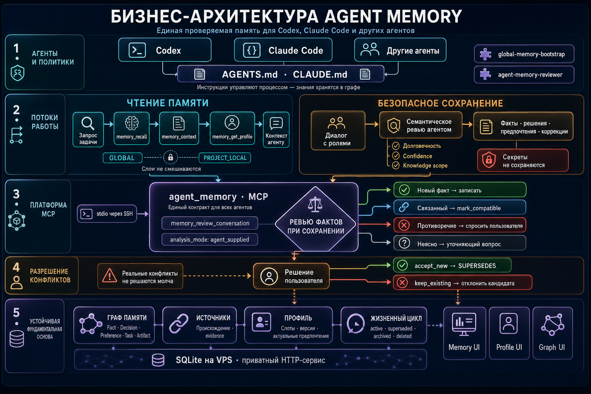
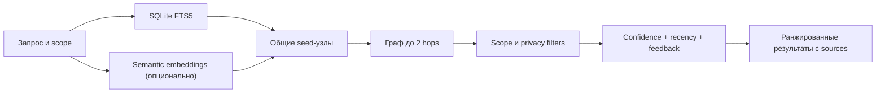

# Agent Memory

[](https://github.com/MaskusNES/memaskus/actions/workflows/ci.yml)
[](https://nodejs.org/)
[](LICENSE)

Общая, независимая от конкретного AI-агента память с HTTP API, MCP-адаптером,
графом знаний, проверяемыми источниками и управляемым жизненным циклом.

Agent Memory позволяет Codex, Claude Code и другим MCP-клиентам читать и
обновлять одно хранилище долговременных фактов, решений, предпочтений и задач.
Проект local-first: для базовой установки достаточно Node.js и одного файла
SQLite.

> Статус проекта: **alpha**. API и схема данных уже покрыты тестами, но до версии
> 1.0 возможны несовместимые изменения. Сервис рассчитан на одного доверенного
> пользователя или небольшую доверенную среду, а не на публичный multi-tenant SaaS.

## Что можно сделать за пять минут

- **Дать агентам общую память.** Подключите Codex, Claude Code или другой
  MCP-клиент к одному локальному сервису — важные факты, решения и предпочтения
  не останутся в пределах одного чата.
- **Сохранить решения в контексте проекта.** Записывайте, откуда взялось
  решение, ищите его по смыслу и отделяйте общие знания от знаний конкретного
  проекта, пользователя или рабочей области.
- **Безопасно разобрать диалог.** Получайте кандидаты в долговременную память,
  подтверждайте их до записи и выносите реальные противоречия на решение
  человека.

Для локального запуска достаточно Node.js и SQLite:

```bash
git clone https://github.com/MaskusNES/memaskus.git
cd memaskus
npm ci
npm run dev
```

После запуска подключите MCP-клиент по [короткой инструкции](#mcp) или
воспользуйтесь готовыми локальными и SSH-конфигурациями в
[`mcp-setup.md`](mcp-setup.md).

## Quick setup guide

1. **Установите prerequisites:** Node.js 22+, npm и Git.
2. **Склонируйте и соберите сервис:**

   ```bash
   git clone https://github.com/MaskusNES/memaskus.git
   cd memaskus
   npm ci
   npm run build
   ```

3. **Запустите HTTP API:**

   ```bash
   npm start
   ```

   Проверьте `http://127.0.0.1:3010/ready` и откройте
   `http://127.0.0.1:3010/memory`. База и миграции создадутся автоматически.

4. **Подключите MCP-клиент:** используйте команду `node`, абсолютный путь к
   `dist/mcp/server.js` и переменную
   `MEMORY_API_URL=http://127.0.0.1:3010`. Готовые локальные и SSH-примеры есть
   в [`mcp-setup.md`](mcp-setup.md).
5. **Установите agent workflow:** скопируйте папки из [`skills/`](skills) в
   `~/.codex/skills/` для Codex. Claude Code автоматически использует
   [`CLAUDE.md`](CLAUDE.md) и project-level reviewer из [`.claude/agents/`](.claude/agents).
6. **Проверьте запись и recall:**

   ```bash
   npm run memory -- remember "Use SQLite for the first release" --type Decision --project project:demo
   npm run memory -- recall "Which database should we use?" --project project:demo --sources
   ```

Для API key, embeddings, VPS и production-настроек перейдите к подробным
разделам ниже.



## Возможности

- единая память для любых клиентов через HTTP и MCP;
- типизированные узлы памяти и связи между ними;
- области видимости: global, user, project, workspace, agent и conversation;
- раздельные слои глобальных и проектных знаний;
- полнотекстовый поиск FTS5 с локальным token fallback;
  русские запросы дополнительно используют ограниченные основы регулярных именных
  словоформ (например, «задача/задачи/задачу/задачами» и
  «решение/решения/решению/решениями») и варианты е/ё на существующем индексе.
  Это не полная морфология: основа содержит минимум 3 буквы, слова короче
  4 букв не сокращаются. Обрабатываются первые 16 уникальных токенов, для
  каждого — до 8 вариантов написания слова и до 8 вариантов основы. Исходный
  префикс сохраняется; token fallback сравнивает те же нормализованные основы,
  а точное совпадение токена получает больший вес, чем нормализованное;
- ограниченное распространение релевантности по графу до двух переходов;
- опциональный семантический поиск через подключаемый embedding-провайдер;
- ранжирование по тексту, смыслу, графу, confidence, свежести и feedback;
- источники, evidence и объяснение происхождения каждой записи;
- кандидаты памяти, ревью диалогов и разрешение противоречий;
- изменяемый профиль пользователя с историей версий;
- архивирование, исправление и удаление памяти;
- встроенные Memory, Profile и Graph UI;
- версионируемые миграции, проверяемые резервные копии и systemd-конфигурация;
- метрики качества поиска: Hit Rate, Recall, MRR и nDCG.

## Как устроен поиск



Если embedding-провайдер не настроен или временно недоступен, recall продолжает
работать локально через FTS5, граф и feedback.

## Требования

- Node.js 22 или новее;
- npm 10 или новее;
- Git;
- Linux, macOS или Windows.

`better-sqlite3` обычно устанавливается из готового бинарного пакета. На редкой
платформе без подходящего бинарника могут понадобиться Python и C/C++ build tools.

## Быстрый старт

```bash
git clone https://github.com/MaskusNES/memaskus.git
cd memaskus
npm ci
npm run dev
```

При первом запуске сервис создаст `data/memory.sqlite` и автоматически применит
все миграции. По умолчанию он слушает только `127.0.0.1:3010`.

Проверка:

```bash
curl http://127.0.0.1:3010/health
curl http://127.0.0.1:3010/ready
```

Интерфейсы:

- Memory UI: <http://127.0.0.1:3010/memory>
- Profile UI: <http://127.0.0.1:3010/profile>
- Graph UI: <http://127.0.0.1:3010/graph>

Во втором терминале можно записать и найти первую память:

```bash
npm run memory -- remember "Use SQLite for the first release" --type Decision --project project:demo
npm run memory -- recall "Which database should we use?" --project project:demo --sources
```

## Production-сборка

```bash
npm ci
npm run build
npm test
npm start
```

Для запуска с файлом окружения используйте встроенную поддержку Node.js:

```bash
cp .env.example .env
npm run build
node --env-file=.env dist/index.js
```

Приложение само не загружает `.env`; переменные должны передаваться оболочкой,
process manager, контейнером или флагом `node --env-file`.

## Конфигурация

| Переменная | По умолчанию | Назначение |
| --- | --- | --- |
| `HOST` | `127.0.0.1` | Адрес HTTP-сервера. Для non-loopback обязателен API key. |
| `PORT` | `3010` | Порт HTTP-сервера. |
| `MEMORY_DB_PATH` | `data/memory.sqlite` | Путь к SQLite базе. |
| `MEMORY_API_KEY` | не задан | Защищает `/v1/*`; передаётся как `x-memory-api-key` или Bearer token. |
| `MEMORY_API_URL` | `http://127.0.0.1:3010` | Адрес API для CLI и MCP-процесса. |
| `MEMORY_EMBEDDING_PROVIDER` | выключен | `openai` для семантического recall; `none` или пустое значение для local-only. |
| `OPENAI_API_KEY` | не задан | Нужен только при `MEMORY_EMBEDDING_PROVIDER=openai`. |
| `MEMORY_EMBEDDING_MODEL` | `text-embedding-3-small` | Модель embeddings. |
| `MEMORY_EMBEDDING_DIMENSIONS` | размер модели | Необязательное сокращение размерности. |
| `MEMORY_EMBEDDING_TIMEOUT_MS` | `15000` | Таймаут запроса к провайдеру. |
| `MEMORY_EMBEDDING_BASE_URL` | OpenAI API | Необязательный совместимый endpoint. |

Полный безопасный пример находится в [.env.example](.env.example).

### Включение семантического поиска

```bash
export MEMORY_EMBEDDING_PROVIDER=openai
export OPENAI_API_KEY="set-this-in-your-secret-store"
export MEMORY_EMBEDDING_MODEL=text-embedding-3-small
npm start
```

Векторы создаются лениво и кэшируются в SQLite. Записи с уровнем
`sensitive` или `secret` никогда не передаются embedding-провайдеру. При
изменении, архивировании или удалении записи её сохранённый вектор очищается.

## MCP

Сначала запустите HTTP-сервис и соберите проект:

```bash
npm run build
npm start
```

Затем настройте любой MCP-клиент на stdio-процесс:

```text
command: node
args: ["/absolute/path/to/memaskus/dist/mcp/server.js"]
env:
  MEMORY_API_URL: http://127.0.0.1:3010
  MEMORY_API_KEY: <тот же ключ, если включён>
```

Основные MCP tools:

- `memory_context`, `memory_get_profile`, `memory_recall`, `memory_list`;
- `memory_remember`, `memory_update`, `memory_feedback`;
- `memory_review_conversation`;
- `memory_list_candidates`, `memory_approve_candidate`,
  `memory_reject_candidate`, `memory_merge_candidate`;
- `memory_list_conflicts`, `memory_resolve_conflict`;
- `memory_explain`, `memory_graph`, `memory_archive`, `memory_delete`.

Локальная и удалённая конфигурация описаны в [mcp-setup.md](mcp-setup.md),
а отдельный пример для Claude Code — в
[claude-code-memory-setup.md](claude-code-memory-setup.md).

## Навыки и инструкции агентов

MCP предоставляет операции, но сам по себе не объясняет агенту, **когда** читать
память, **что** считать долговременным знанием и **как** разбирать конфликты. Это
делает отдельный orchestration layer из skills, project instructions и Claude
subagent.

| Компонент | Среда | Роль |
| --- | --- | --- |
| [`AGENTS.md`](AGENTS.md) | Codex | Задаёт project id, порядок bootstrap, правила записи, scope и безопасности. |
| [`skills/global-memory-bootstrap`](skills/global-memory-bootstrap/SKILL.md) | Codex skill | Загружает глобальные предпочтения и operating rules перед началом задачи. |
| [`skills/agent-memory-reviewer`](skills/agent-memory-reviewer/SKILL.md) | Codex skill | Семантически разбирает диалог и безопасно записывает durable knowledge через MCP. |
| [`CLAUDE.md`](CLAUDE.md) | Claude Code | Задаёт тот же контракт bootstrap/read/write для Claude. |
| [`.claude/agents/agent-memory-reviewer.md`](.claude/agents/agent-memory-reviewer.md) | Claude Code subagent | Выполняет специализированное ревью диалога и conflict classification. |
| [`mcp-setup.md`](mcp-setup.md) | Любой MCP-клиент | Подключает tools к одному HTTP/SQLite service. |

### Что изменяют `AGENTS.md` и `CLAUDE.md`

Оба файла превращают обычный MCP-сервер в предсказуемый memory workflow:

1. Перед проектной работой агент читает глобальный слой через `memory_recall`.
2. Затем отдельно загружает `project_local` context для текущего `project_id`.
3. Mutable preferences читаются через `memory_get_profile`/`memory_context`.
4. Явная безопасная просьба «запомни» может использовать `memory_remember`.
5. Знания, извлечённые из диалога, проходят через reviewer и
   `memory_review_conversation` с `analysis_mode: "agent_supplied"`.
6. Связанные, но совместимые записи помечаются `mark_compatible`.
7. Настоящие противоречия показываются пользователю; `accept_new` или
   `keep_existing` применяется только после его выбора.
8. Credentials и private keys никогда не сохраняются.

`AGENTS.md`, `CLAUDE.md` и skills — это **инструкции процесса**, а не база
знаний. Источником долговременной памяти остаётся MCP-backed graph store.

### Установка Codex skills

После настройки MCP скопируйте skills в персональный каталог Codex.

Linux/macOS:

```bash
mkdir -p ~/.codex/skills
cp -R skills/global-memory-bootstrap ~/.codex/skills/
cp -R skills/agent-memory-reviewer ~/.codex/skills/
```

PowerShell:

```powershell
New-Item -ItemType Directory -Force "$env:USERPROFILE\.codex\skills" | Out-Null
Copy-Item -Recurse -Force .\skills\global-memory-bootstrap "$env:USERPROFILE\.codex\skills\"
Copy-Item -Recurse -Force .\skills\agent-memory-reviewer "$env:USERPROFILE\.codex\skills\"
```

После первой установки перезапустите Codex. Подробности и назначение навыков:
[`skills/README.md`](skills/README.md).

### Claude Code

В этом репозитории Claude Code автоматически получает [`CLAUDE.md`](CLAUDE.md)
и project-level subagent
[`.claude/agents/agent-memory-reviewer.md`](.claude/agents/agent-memory-reviewer.md).
Для использования subagent во всех проектах его можно скопировать в
`~/.claude/agents/`. Полная инструкция находится в
[`claude-code-memory-setup.md`](claude-code-memory-setup.md).

### Подключение другого репозитория

1. Настройте его MCP-клиент на тот же `agent_memory` service.
2. Скопируйте `AGENTS.md` или `CLAUDE.md` в корень проекта.
3. Замените `project:agent-memory` на стабильный уникальный project id.
4. Установите skills или Claude subagent.
5. Не смешивайте `global` и `project_local` layers и не храните знания в самих
   instruction files.

## HTTP API

| Метод | Endpoint | Назначение |
| --- | --- | --- |
| `GET` | `/health`, `/ready` | Liveness и readiness. |
| `GET`, `POST` | `/v1/memories` | Список и создание памяти. |
| `PATCH`, `DELETE` | `/v1/memories/:id` | Исправление или удаление памяти. |
| `GET` | `/v1/memories/:id/explain` | Источники, revisions и связи. |
| `POST` | `/v1/memories/:id/feedback` | Оценка качества памяти. |
| `POST` | `/v1/memories/:id/archive` | Архивирование с сохранением истории. |
| `POST` | `/v1/recall` | Гибридный поиск. |
| `POST` | `/v1/links` | Создание графовой связи. |
| `GET` | `/v1/graph` | Снимок графа. |
| `POST` | `/v1/ingest/conversation` | Детерминированное извлечение кандидатов. |
| `POST` | `/v1/review/conversation` | Ревью диалога и conflict gating. |
| `GET` | `/v1/candidates` | Кандидаты на запись. |
| `POST` | `/v1/candidates/:id/{approve,reject,merge}` | Решение по кандидату. |
| `GET`, `POST` | `/v1/conflicts`, `/v1/conflicts/:id/resolve` | Просмотр и разрешение конфликтов. |
| `GET`, `POST` | `/v1/profile`, `/v1/profile/slots` | Mutable profile layer. |
| `POST` | `/v1/profile/context` | Компактный контекст для агента. |

Пример прямого HTTP-запроса:

```bash
curl -X POST http://127.0.0.1:3010/v1/recall \
  -H "content-type: application/json" \
  -d '{
    "query": "current storage decisions",
    "scope": {"kind": "project", "project_id": "project:demo"},
    "knowledge_scope": "project_local",
    "types": ["Decision", "Fact"],
    "limit": 10,
    "include_sources": true
  }'
```

## CLI

```bash
npm run memory -- --help
npm run memory -- remember --help
```

Доступны команды `remember`, `recall`, `explain`, `link`, `ingest`, `review`,
`candidates`, `approve`, `reject`, `conflicts` и `resolve-conflict`. CLI обращается
к `MEMORY_API_URL` и использует `MEMORY_API_KEY`, если он задан.

## Оценка качества retrieval

Dataset — JSON-массив запросов с ожидаемыми ID:

```json
[
  {
    "id": "storage-decision",
    "query": "Which database did we choose?",
    "scope": { "kind": "project", "project_id": "project:demo" },
    "knowledge_scope": "project_local",
    "expected_ids": ["node_example"]
  }
]
```

Запуск:

```bash
npm run memory:eval -- --dataset ./evals/retrieval.json --db ./data/memory.sqlite --limit 10
```

## Резервные копии

Не копируйте работающий SQLite-файл обычной файловой командой. Используйте
встроенный online backup:

```bash
npm run build
node dist/cli/backup-database.js backup data/memory.sqlite backups/memory.sqlite.bak
node dist/cli/backup-database.js verify backups/memory.sqlite.bak
```

Каталоги `data/`, `backups/` и `.env` исключены из Git.

## Развёртывание на VPS

Готовые systemd unit и безопасные скрипты находятся в [deploy](deploy).
Пошаговая инструкция: [remote-memory-vps-setup.md](remote-memory-vps-setup.md).

Рекомендуемая схема — держать HTTP-сервис на loopback-интерфейсе VPS, а MCP
запускать через SSH. Если API всё же публикуется в сеть, используйте TLS,
firewall/reverse proxy и уникальный `MEMORY_API_KEY`.

## Безопасность и приватность

- очевидные API keys, токены и private keys отклоняются или редактируются;
- `sensitive` и `secret` content скрывается из публичных ответов;
- глобальный и project-local слои не смешиваются автоматически;
- реальные противоречия требуют явного решения пользователя;
- база SQLite **не зашифрована** — защищайте файл правами ОС и шифрованием диска;
- встроенный API key — базовый барьер, а не полноценная multi-user IAM-система.

Подробнее и порядок сообщения об уязвимостях: [SECURITY.md](SECURITY.md).

## Разработка

```bash
npm ci
npm run typecheck
npm test
npm run build
```

Правила оформления изменений находятся в [CONTRIBUTING.md](CONTRIBUTING.md),
история релизов — в [CHANGELOG.md](CHANGELOG.md).

## Структура проекта

```text
src/db/       SQLite connection, schema, migrations and backup
src/domain/   graph, recall, privacy, profile and lifecycle logic
src/routes/   Fastify HTTP routes
src/mcp/      MCP stdio adapter over HTTP
src/cli/      operational and maintenance commands
skills/       installable Codex orchestration skills
.claude/      project-level Claude Code subagents
public/       built-in Memory, Profile and Graph UI
deploy/       systemd installation and restore scripts
tests/        integration, security and retrieval tests
```

## Roadmap

- стабильный API-контракт 1.0 и OpenAPI-схема;
- фоновые очереди embeddings для больших баз;
- vector index вместо линейного cosine scan;
- дополнительные embedding-провайдеры;
- улучшенное entity resolution и relation-specific graph ranking;
- контейнерный deployment и наблюдаемость;
- SDK для TypeScript и Python.

## Лицензия

[MIT](LICENSE) © 2026 MaskusNES contributors.
